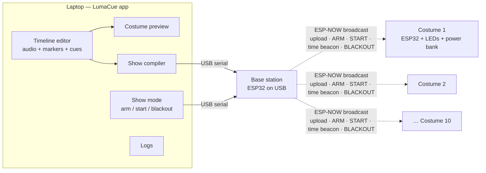

# LumaCue — Software Architecture (Draft for Review)

**Status:** For owner review. **Desktop vs web is NOT decided.** It is decided at the end of this review (§5).
**Constraints from the owner (29 Oct 2026):** ~10 dancers · event in the first week of December 2026 (~5 weeks away) · total budget ₹20,000 · the software must create cues, sync the costumes and run the show.

## 1. Key principle: costumes play the show themselves

The laptop **does not stream light frames live**. Before the show it uploads each costume's cue list. At showtime it sends one "START" (plus periodic time beacons). Each costume plays its cues from its own memory and clock.

Why: if Wi-Fi/radio drops or the laptop crashes mid-show, the costumes keep dancing in time. It also means the software is **not in the real-time path during the show**, and that makes a web app viable (see §5).

## 2. System overview

The hardware assumed here (ESP32 per costume + ESP32 base + ESP-NOW) is the agent's recommendation in `hardware_components_review.md`. It is **not yet bench-tested**.

## 3. Modules

| Module | Responsibility | Reuses existing code? |
|---|---|---|
| Project store | `ShowProject` JSON (versioned): audio ref, markers, dancers, zones, cues, devices. Save / open / duplicate | Zustand store (extended) |
| Audio + timeline engine | Load local audio file, waveform, play/scrub, markers, master clock = audio position | New |
| Cue / effect model | Cues `{target, startMs, durationMs, effect, params}`; effects: blackout, solid, fade, flash, chase, gradient, alternate, custom sequence; brightness cap | Preset step model, colour picker |
| Preview renderer | `render(project, tMs) → frame` drawn on body silhouettes | New. **The same function is ported to firmware** so the preview matches the costume |
| Device manager | List costumes (ID, firmware version, battery if reported, last seen); assign costume ↔ dancer | WS client pattern |
| Show compiler | Validate + compile each dancer's cues into a compact binary; CRC checksum | New |
| Transport | Laptop ↔ base ESP32 over USB serial; base ↔ costumes over ESP-NOW | Replaces Pi GPIO/IR server |
| Show mode | Separate locked screen: preflight → ARM → countdown → START → guarded STOP/BLACKOUT | Emergency-off concept, GlobalControlBar |
| Diagnostics | Start time, acks, transfer results, drift reports; export log file | LogPanel |

## 4. Sync protocol (draft)

1. **Upload** (pre-show, minutes before): the base sends each costume its show chunks; the costume replies with a CRC; the app marks it ✅ only on a matching CRC.
2. **ARM**: each costume confirms show ID + version + battery. The app shows a green tile per dancer.
3. **START**: broadcast `START(showId, t0)` 3× within ~50 ms; costumes start at local time t0.
4. **Beacons**: the base broadcasts the current show time every 500 ms; costumes nudge their clock (no jumps).
5. **Link loss**: the costume keeps playing from its local clock. Drift from a crystal-based MCU clock over a 3-min show is expected to be small. **This is an estimate and will be measured on the bench.**
6. **BLACKOUT**: broadcast and repeated; plus a **physical switch on each costume** (the true emergency cutoff).
7. **Missed START**: a costume that hears a beacon but missed START joins at the beacon's show time.

Provisional target: costumes within ±20 ms of each other (below what an audience can see on a cue). It will be validated with a phone slow-motion video of all costumes against a flash cue.

## 5. Desktop vs web — the decision to make

| Criterion | A. Web app (Chrome/Edge, run locally) + Web Serial | B. Web app + local Node bridge (like today's `hardware/server.js`, serial instead of GPIO) | C. Desktop app (Tauri or Electron around the same React UI) |
|---|---|---|---|
| Reuses current Next.js code | Fully | Fully, + reuses the WS client/server pattern | UI fully; needs a new shell |
| Talk to base ESP32 over USB | Web Serial API (Chrome/Edge only) | Node `serialport` — any browser | Native |
| Local audio + project files | File picker / File System Access API (Chrome/Edge) | Bridge can read/write files on disk | Native |
| Works offline at the venue | Yes, if run from `localhost` (or installed as a PWA) | Yes (two processes to start) | Yes, single installer |
| Moving parts at showtime | 1 (browser) | 2 (browser + bridge) | 1 (app) |
| Extra skills / toolchain | None | Small (already done once) | Tauri needs Rust; Electron adds ~100 MB and packaging work |
| Time to a December-ready MVP | **Fastest** | Fast | Slowest (+1–2 weeks of packaging/setup) |
| Distribution to clients later | Share a URL / local build | Harder | Best (installer) |
| Risk | Chrome-only; browser tab must not be closed in show mode | Bridge must be running; extra failure point | Schedule risk before December |

**Agent's recommendation (for discussion): A for December.** Build LumaCue as a web app run locally in Chrome/Edge, with Web Serial to the base station. Keep the code shell-agnostic so it can be wrapped as a desktop app (C) after the event if you want an installable product. Because costumes play locally (§1), the browser's timing precision only matters for editing and preview, not the live show.

What would change this: if Web Serial proves unreliable with the ESP32's USB chip in a quick test, switch to B; if offline installers for clients matter before December, choose C.

## 6. Failure handling

| Failure | Behaviour |
|---|---|
| Corrupt / old project file | Schema validation; refuse to load with a clear message; keep an automatic `.bak` |
| Interrupted upload | CRC mismatch → costume keeps its previous show and is marked ❌; ARM blocked |
| Firmware/show version mismatch | ARM blocked for that costume |
| Laptop / browser crash after START | Costumes continue playing locally |
| Radio lost mid-show | Costumes continue; rejoin on the next beacon |
| Accidental STOP | Show mode requires hold-to-confirm (e.g. hold 1 s) for stop; blackout is a separate, guarded button |
| Costume power fails | That dancer goes dark; the others continue. Spare costume swap during a blackout |

## 7. Questions for the review
1. Will one laptop with Chrome or Edge be available at the venue?
2. Is it acceptable that LumaCue runs only in Chrome/Edge for December?
3. Do you want clients to install LumaCue themselves later (pushes towards desktop), or will you always operate it?
